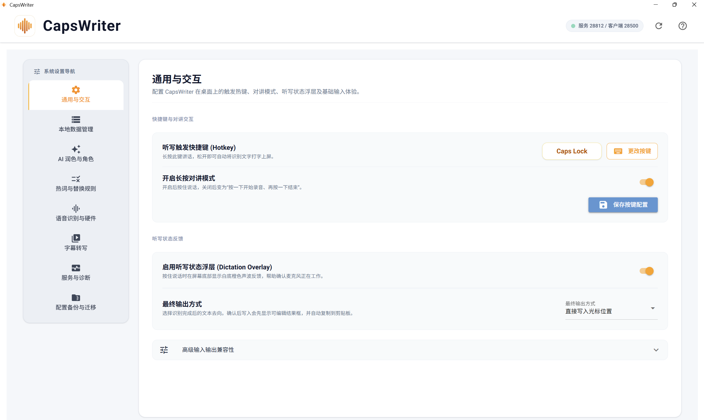

# CapsWriter-Offline GUI 增强版


> 本项目基于 [HaujetZhao/CapsWriter-Offline](https://github.com/HaujetZhao/CapsWriter-Offline) 开发，在原项目离线语音输入能力基础上，增加桌面控制中心、转写管理、AI 配置、浮动结果框、输入历史和发布包。

CapsWriter-Offline GUI 增强版是一个 Windows 离线语音输入工具。它可以在本地完成语音识别，把听写结果输入到当前光标位置，并提供桌面控制中心来管理快捷键、模型、热词、历史记录、音视频转写、AI 角色、备份和诊断。



## 项目功能

- 离线语音输入：本地加载 ASR 模型，按住快捷键说话，松开后将识别结果写入当前应用。
- 桌面控制中心：通过原生窗口管理快捷键、识别模型、输出方式、热词、AI 配置和运行状态。
- 快捷键与对讲模式：支持自定义听写快捷键，并可切换长按说话或单击开始/结束录音。
- 听写状态浮层：按住说话时在屏幕底部显示录音状态和音量反馈，帮助确认麦克风正在工作。
- 两种输出方式：支持直接写入光标位置，也支持先显示可编辑确认框，再由用户确认后写入。
- 输入历史：保存最近听写结果，支持搜索、复制、查看全文和清空。
- 本地数据管理：集中查看听写日记、录音文件、转写输出和日志，方便排查和清理。
- 热词与替换规则：在控制中心里维护 `hot.txt` 和 `hot-rule.txt`，修正常用词、项目名、标点和固定格式。
- 语音识别与硬件：选择本地 ASR 模型、识别语言、格式化选项、后端和硬件加速策略。
- 字幕转写：选择音频或视频文件，生成 `TXT`、`JSON`、`SRT` 和合并文本。
- AI 润色与角色：可选配置 OpenAI 兼容 API 档案，用于润色、翻译、小助理、大助理和自定义角色。
- 服务与诊断：查看服务端、客户端、GUI、托盘和模型状态，支持重启组件和完全退出。
- 配置备份与迁移：导出/导入常用设置，默认不导出私有 API Key。

## 安装、更新与运行

### 方式一：日常轻量更新（已有用户 / Bug 修复推荐）

如果您之前已经在使用 CapsWriter，当 GitHub 仓库有日常优化或小 Bug 修复时，**完全不需要重新下载几个 G 的完整发布包**，只需轻量覆盖代码即可：

1. **获取最新代码**：
   - **方式 A（Git 用户）**：在本地 CapsWriter 目录下直接打开终端执行：
     ```powershell
     git pull
     ```
   - **方式 B（直接下载）**：在 GitHub 页面点击右上角绿色 **`Code`** 按钮 ➔ 选择 **`Download ZIP`**，下载并解压。
2. **复制覆盖代码文件**：
   - 将解压后的最新代码复制并覆盖到您现有的本地 CapsWriter 目录中：
     - **需要覆盖的文件/目录**：`core/`、`web_gui/`、`LLM/`、`run_app.py`、`start_server.py`、`start_client.py` 等代码文件。
     - ⚠️ **请保留您的个人数据与模型**：**不要覆盖或删除**您本地的 `models/`（模型文件）、`input_history.jsonl`（历史记录）以及个人自定义的 `hot.txt` / `hot-rule.txt`（热词规则表）。
3. **双击启动**：
   - **绿色独立版用户**：直接双击根目录下的 **`CapsWriter.exe`** 即可。
   - **源码/Python 环境用户**：双击 **`启动 CapsWriter 智能控制中心.bat`**。

---

### 方式二：首次完整安装（新用户懒人推荐）

初次接触本工具的用户，推荐直接从 GitHub Releases 下载打包好的独立运行包：

- 前往 [GitHub Releases](../../releases) 页面下载：
  - `CapsWriter-Full.zip`：完整版，内置本地 ASR 模型，解压后即可开箱即用。
  - `CapsWriter-Lite.zip`：精简版，不内置 ASR 模型，体积更小；首次运行可在“语音识别与硬件”页面按指引下载模型并放入 `models/` 目录。
- 解压后双击运行包内的 **`CapsWriter.exe`** 即可。

> **提示**：日常使用中遇到小版本修复，直接按上述**方式一**更新代码即可，极速便捷；未来只有在重大功能重构或依赖环境升级的大版本时，才需要重新下载新的发布包。

---

### 方式三：从源码环境部署（开发者 / Python 运行）

#### 环境要求
- Windows 10 / 11
- Python 3.11
- 本地 ASR 模型文件（存放在 `models/` 对应子目录下）

#### 安装依赖
```powershell
pip install -r requirements-client.txt
pip install -r requirements-server.txt
```

#### 准备模型
将语音模型文件放入 `models/` 对应目录。也可在控制中心“语音识别与硬件”页面查看模型推荐与下载入口。

#### 启动
终端运行：
```powershell
python run_app.py
```
或在文件资源管理器中直接双击：
```text
启动 CapsWriter 智能控制中心.bat
```
启动后会同时拉起 ASR 服务端、听写客户端、控制中心 GUI 和系统托盘菜单。

## 基本使用

1. 打开 CapsWriter 控制中心。
2. 在“通用与交互”里设置听写快捷键。
3. 按住快捷键说话。
4. 松开快捷键后，识别结果会写入当前光标位置。

常用快捷键包括 `Caps Lock`、鼠标侧键 `X2`、`F8`、`F9`、`Ctrl + Space` 和 `Ctrl + Alt + Space`。

如果启用“确认后写入”，识别完成后会先显示可编辑确认框，并把文本复制到剪贴板。

## 文档

- [控制中心使用说明](docs/控制中心说明.md)
- [常见问题](docs/常见问题.md)
- [热词功能如何使用](docs/热词功能如何使用.md)
- [文件转录功能如何使用](docs/文件转录功能如何使用.md)
- [显卡加速的若干问题](docs/显卡加速的若干问题.md)
- [模型下载的若干问题](docs/模型下载的若干问题.md)

控制中心右上角的问号按钮也可以打开 README 和 `docs/` 文档目录。
