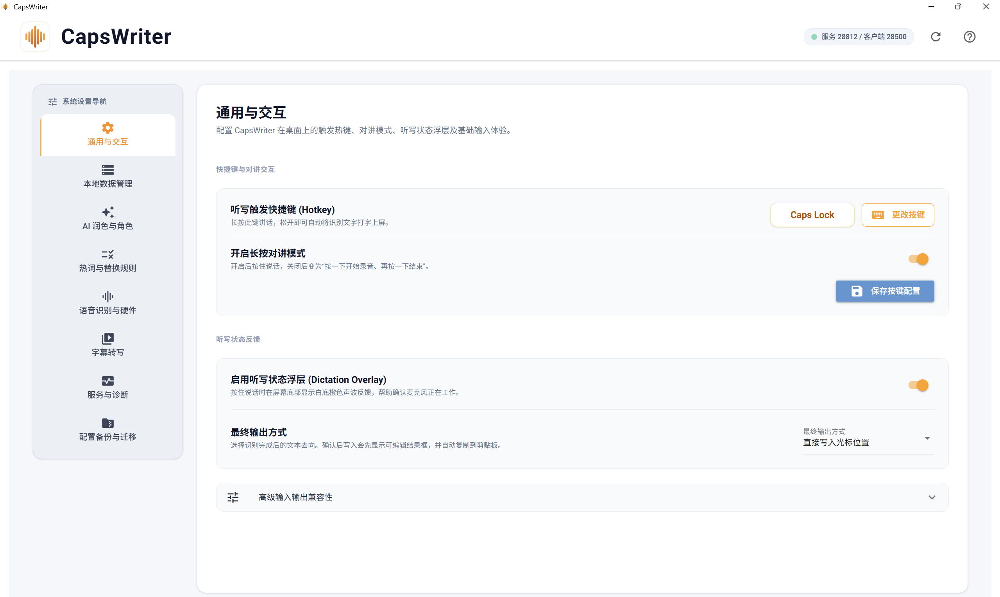

# CapsWriter-Offline GUI 增强版 · V1


> 本项目基于 [HaujetZhao/CapsWriter-Offline](https://github.com/HaujetZhao/CapsWriter-Offline) 开发，在原项目离线语音输入能力基础上，增加桌面控制中心、转写管理、AI 配置、浮动结果框、输入历史和产品化发行工具。

CapsWriter-Offline GUI 增强版是一个 Windows 离线语音输入工具。它可以在本地完成语音识别，把听写结果输入到当前光标位置，并提供桌面控制中心来管理快捷键、模型、热词、历史记录、音视频转写、AI 角色、备份和诊断。

## V1 当前状态

当前开发分支为 `feat/capswriter-v1-20261122`，产品版本为 **`1.0.0-rc.1` 源码候选**。本分支已实现首次设置、模型中心、后台下载与任务管理、数据保护，以及 Windows EXE 安装版和 Portable ZIP 的构建脚本。

**Windows 原生运行、麦克风与桌面输入、安装/升级/卸载尚待本地实机验收；本轮尚未公开发行 EXE 或 Portable 包。** 源码检查、模拟测试及 HTML 原型均不能替代这些验证。最新交付 SHA、已执行证据和待验证项目以[当前交接](docs/项目管理/当前交接.md)为准。

- 本地接续的唯一完整入口：[V1 本地拉取与 Windows 验收](docs/项目管理/任务/V1-本地拉取与Windows验收-20261122.md)。
- Windows 打包、依赖和发行门禁：[构建说明](packaging/README.md)。
- 产品网站：[官网源码目录](website/)与[本地预览说明](website/README.md)。网站尚未部署，未核验的正式包下载按钮保持禁用。



*上图为仓库既有控制中心截图，不作为本次 V1 Windows 实机验收证据。*

## 项目功能

- 离线语音输入：本地加载 ASR 模型，按住快捷键说话，松开后将识别结果写入当前应用。
- 桌面控制中心：通过原生窗口管理快捷键、识别模型、输出方式、热词、AI 配置和运行状态。
- 快捷键与对讲模式：支持自定义听写快捷键，并可切换长按说话或单击开始/结束录音。
- 听写状态浮层：按住说话时在屏幕底部显示录音状态和音量反馈，帮助确认麦克风正在工作。
- 两种输出方式：支持直接写入光标位置，也支持先显示可编辑确认框，再由用户确认后写入。
- 输入历史：保存最近听写结果，支持搜索、复制、查看全文和清空。
- 本地数据管理：集中查看听写日记、录音文件、转写输出和日志，方便排查和清理。
- 热词与替换规则：在控制中心里维护 `hot.txt` 和 `hot-rule.txt`，修正常用词、项目名、标点和固定格式。
- 模型中心：选择本地 ASR 模型、识别语言、格式化选项、后端和硬件加速策略，保留原有高级设置。
- 字幕转写：选择音频或视频文件，生成 `TXT`、`JSON`、`SRT` 和合并文本。
- AI 润色与角色：可选配置 OpenAI 兼容 API 档案，用于润色、翻译、小助理、大助理和自定义角色。
- 服务与诊断：查看服务端、客户端、GUI、托盘和模型状态，支持重启组件和完全退出。
- 配置备份与迁移：导出/导入常用设置，默认不导出私有 API Key。

控制中心保留现有八项导航及其顺序：

| 页面 | 主要内容 |
| --- | --- |
| 通用与交互 | 快捷键、长按/单击模式、听写浮层、直接输入/确认后写入和输入历史 |
| 本地数据管理 | 听写日记、录音、转写产物和日志的查看与清理 |
| AI 润色与角色 | API 档案、默认润色、翻译和自定义角色；由用户选择启用 |
| 热词与替换规则 | 热词、正则替换规则、校验及外部修改冲突提示 |
| 模型中心 | 模型列表、推荐、下载/校验/加载状态，语言与硬件高级参数 |
| 字幕转写 | 音视频转写、持久化任务、单项重试和结果查看 |
| 服务与诊断 | 真实运行状态、组件恢复、手动检查更新和完全退出 |
| 配置备份与迁移 | 导入预览、备份恢复、配置导出和私有数据保护 |

V1 六步首次设置可跳过、可恢复。模型下载完成后还需校验、安装和真实加载；首次明确选择的模型加载成功后启用，后续模型需确认切换。文件任务重试从文件开头处理，不承诺精确断点续转写。

## 安装、更新与运行

### 1. 在独立目录拉取候选代码

已有用户先阅读[完整接续任务](docs/项目管理/任务/V1-本地拉取与Windows验收-20261122.md)，记录原 HEAD、工作区修改和个人资料位置，再创建独立 worktree。原有本地提交、未提交改动、模型、热词、角色、API Key、历史和转写结果均保留在原目录；新候选的试用、依赖安装与验证在新目录完成。

在已有 Git 仓库中可按下例获取指定分支。目标目录必须尚不存在；实际验收还须按接续任务核对交付 SHA。

```powershell
git status --short
git log -1 --oneline
git fetch https://github.com/qianxiaohuaqi-design/CapsWriter-Offline.git feat/capswriter-v1-20261122
git worktree add --detach ..\CapsWriter-V1-preview FETCH_HEAD
cd ..\CapsWriter-V1-preview
```

没有旧工作区时，可克隆到一个全新的目录：

```powershell
git clone --branch feat/capswriter-v1-20261122 --single-branch https://github.com/qianxiaohuaqi-design/CapsWriter-Offline.git CapsWriter-V1-preview
cd CapsWriter-V1-preview
```

本轮不使用直接拉取并覆盖旧目录的升级方式。原有 M1-A 提交和本地修改的差异应先核对，再按完整接续任务处理。

### 2. 创建 Windows 源码运行环境

目标环境为 Windows 10 / 11 x64、Python 3.11 x64。原生控制中心需要 WebView2 Runtime；其检查与官方获取入口见[构建说明](packaging/README.md)。在新的 worktree/目录中创建专用虚拟环境：

```powershell
py -3.11 -m venv .venv-v1
.venv-v1\Scripts\python.exe -m pip install -r requirements-v1.txt
.venv-v1\Scripts\python.exe -m pip check
.venv-v1\Scripts\python.exe run_app.py
```

激活上述虚拟环境后，启动命令等价于 `python run_app.py`。**没有预装模型也可启动控制中心并进入首次设置**；只有真实模型加载成功，且麦克风和快捷键状态可用后，才显示听写就绪。首次安装依赖或运行出现的问题应记录实际错误，本说明不代表该 Windows 环境已经验收通过。

### 3. 在模型中心准备模型

新用户可从六步向导或“模型中心”选择模型，阅读对应许可后下载。SenseVoice 是本轮优先打通的自动下载路径；完整列表同时保留其他既有模型和手动模型入口。已有模型、手动路径及高级参数应先核对，避免试用候选代码时改变原有环境。

关闭控制中心窗口与“完全退出”含义不同：窗口关闭后应用后台可继续管理下载和任务；完全退出会等待安全停止与保存。文件转写、模型/媒体依赖和后台继续运行仍须按 Windows 验收任务实测。

### 4. EXE 安装版、Portable 与后续更新

V1 的两种目标发行方式是当前用户 **EXE 安装版**与 **Portable ZIP**，均不预装大型模型。`tools/build_v1.py`、`v1-app.spec` 和 Inno Setup 脚本已提供，详细步骤见[打包与发行核验](packaging/README.md)。完整发行还需核验 FFmpeg/GGUF 二进制、第三方许可及 Windows 实机结果。

当前请按源码接续流程试用，不把仓库 ZIP、历史发布包或构建候选当作已验收的 V1 正式包。正式发布后再提供经过核验的下载入口。软件内更新采用用户主动检查和明确的升级操作，不进行静默自动覆盖。

## 基本使用

1. 打开 CapsWriter 控制中心；首次使用可完成向导或稍后恢复。
2. 在“模型中心”准备并加载模型，确认真实运行状态。
3. 在“通用与交互”里设置听写快捷键和输出方式。
4. 在目标应用中按住快捷键说话，松开后接收识别结果；单击开始/结束模式按所选设置操作。

常用快捷键包括 `Caps Lock`、鼠标侧键 `X2`、`F8`、`F9`、`Ctrl + Space` 和 `Ctrl + Alt + Space`。

如果启用“确认后写入”，识别完成后会先显示可编辑确认框，并把文本复制到剪贴板。

## 许可与数据

本仓库软件代码的许可见 [MIT LICENSE](LICENSE)。**模型权重、模型衍生物和第三方二进制各自适用其许可证，软件的 MIT 声明不覆盖它们。** 例如当前推荐 SenseVoice 权重的许可在[模型清单](core/product/model_manifest.json)中记录为 FunASR Model Open Source License Agreement v1.1；下载前应查看模型中心所列的具体条款。

本地识别与可选 AI API 的数据行为、配置位置和发布包边界见[隐私与数据说明](packaging/PRIVACY.md)；第三方许可和打包核验流程见[构建说明](packaging/README.md)。

## 文档

- [当前交接与实际进度](docs/项目管理/当前交接.md)
- [V1 本地拉取与 Windows 验收](docs/项目管理/任务/V1-本地拉取与Windows验收-20261122.md)
- [V1 设计冻结与实施总包](docs/项目管理/设计/V1-设计冻结与实施总包-20261122.md)
- [V1 打包与发行核验](packaging/README.md)
- [官网源码与预览](website/README.md)
- [控制中心使用说明](docs/控制中心说明.md)
- [常见问题](docs/常见问题.md)
- [热词功能如何使用](docs/热词功能如何使用.md)
- [文件转录功能如何使用](docs/文件转录功能如何使用.md)
- [显卡加速的若干问题](docs/显卡加速的若干问题.md)
- [模型下载的若干问题](docs/模型下载的若干问题.md)

控制中心右上角的问号按钮也可以打开 README 和 `docs/` 文档目录。
